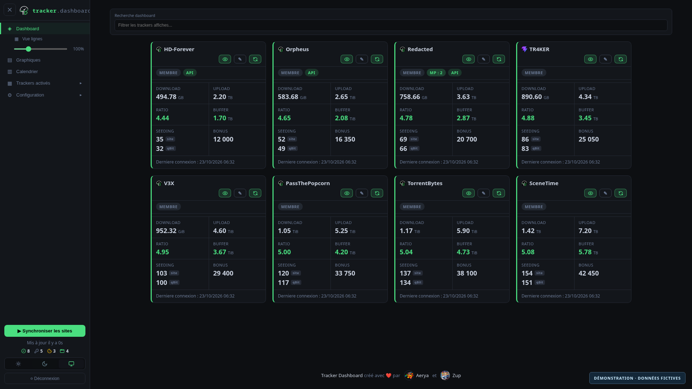
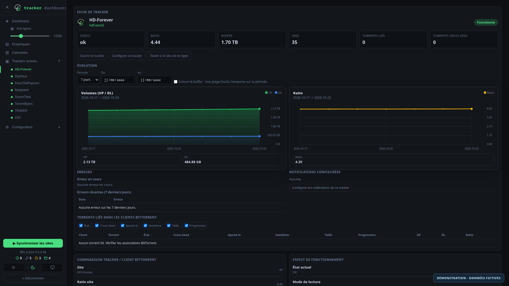
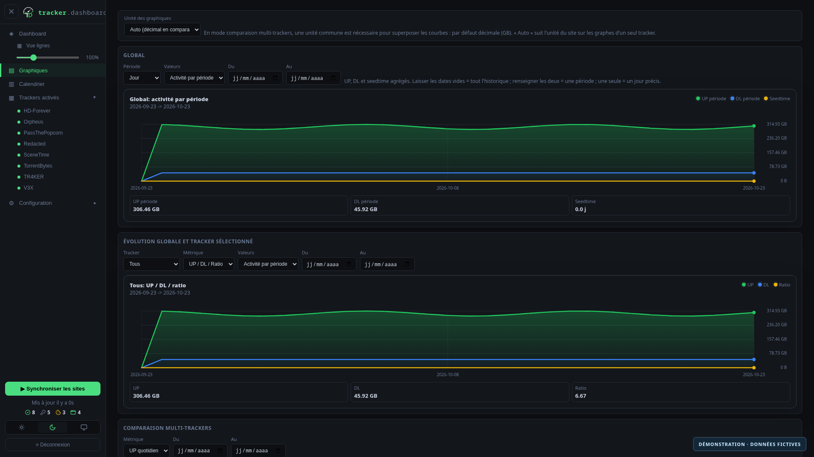
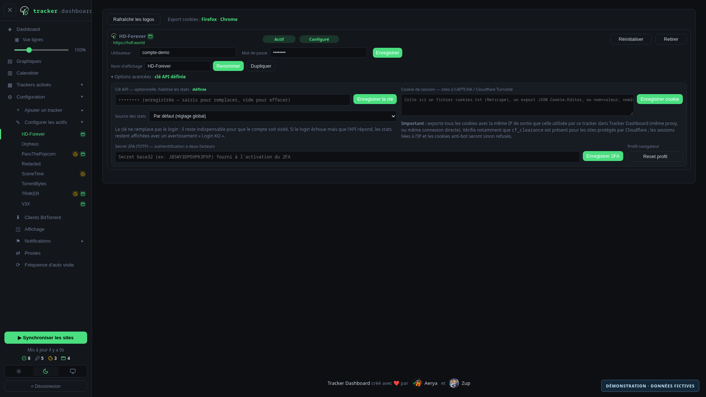

<p align="center">
  
</p>

# Tracker Dashboard

[Français](README.md) | **English**

Tracker Dashboard brings your BitTorrent tracker statistics together in a web interface: upload, download, ratio, buffer, bonus points, seeding torrents and unread private messages, depending on the data available on each site. It schedules visits, keeps a SQLite history and compares tracker statistics with torrents in your BitTorrent clients.

The project is maintained by the [Tracker-Dashboard](https://github.com/Tracker-Dashboard) organization, in collaboration with [Zup](https://github.com/Gusdezup) ([Autovisit-Web](https://github.com/Gusdezup/Autovisit-Web)). **Contributions are welcome**: fixes, new trackers, documentation and features.

<p align="center">
  <strong>Using it? Enjoying it?</strong>
  <a href="https://github.com/Tracker-Dashboard/tracker-dashboard/stargazers"><strong>⭐ Give it a star!</strong></a>
</p>

## Contents

- [Features](#features)
- [Recent updates](#recent-updates)
- [Built-in trackers](#built-in-trackers)
- [Installation and first start](#installation-and-first-start)
- [Interface](#interface) · [Languages](#languages)
- [Session cookies](#session-cookies-captcha--cloudflare-sites)
- [Statistics through tracker APIs](#statistics-through-tracker-apis)
- [Tracker two-factor authentication](#two-factor-authentication-2fa--totp)
- [Multiple accounts per tracker](#multiple-accounts-per-tracker)
- [Screenshots](#screenshots)
- [Automatic visits](#automatic-visits)
- [BitTorrent clients and cross-seed](#bittorrent-clients)
- [Notifications](#notifications)
- [Prometheus and Grafana](#prometheus-and-grafana)
- [Proxies](#proxies)
- [Browser runtime, FlareSolverr and TRAWL](#browser-runtime)
- [Fast fetching](#fast-fetching-curl-impersonate)
- [Random User-Agent](#random-user-agent)
- [Built-in sites and adding a site](#built-in-sites-and-adding-a-site)
- [Acknowledgments](#acknowledgments)

## Features

| Area | What Tracker Dashboard provides |
| --- | --- |
| **Statistics** | Cards or rows, ratio, buffer, UP/DL volumes, bonus points, member class and unread messages where supported; page scraping and compatible APIs |
| **History** | SQLite storage, trend charts, comparisons across trackers and a calendar of successful or failed fetches |
| **Automatic visits** | Global or individual schedules, manual refreshes, caching and retries after certain failures |
| **Multiple accounts** | Tracker duplication, independent credentials and history, custom names and torrent assignment by passkey |
| **BitTorrent clients** | qBittorrent and ruTorrent/rTorrent, announce matching, seeding comparison and links to multiple cross-seed instances |
| **Tracker authentication** | Credentials, session cookies, TOTP and API keys according to each site's supported methods |
| **Networking and browsers** | HTTP/HTTPS/SOCKS/SSH proxies, curl-impersonate, separate Chromium runtime, optional CloakBrowser and FlareSolverr/TRAWL fallbacks |
| **Notifications** | Discord, Apprise and email; global or per-tracker settings, failures, recoveries, statistics and thresholds |
| **Monitoring** | Token-protected Prometheus export and an included Grafana dashboard |
| **Customization** | Light/dark/system themes, card sizes, notes, known incidents and a tracker setup wizard |

## Recent updates

<details>
<summary>Show recent updates</summary>

Changes merged into the main branch, from newest to oldest. Availability on your instance depends on the installed image.

### November 2026

- **November 13 — Optional proxy:** trackers are no longer blocked without an active proxy, and the “Explicitly allow direct connections without a proxy” checkbox is gone. Without a proxy, connections are direct; global and per-tracker proxies remain available. See [Proxies](#proxies).
- **November 13 — Expired session:** when the WebUI session has expired or was closed in another tab, the dashboard sends you to the login page instead of showing empty cards, then brings you back to the original view after you sign in again. ([#247](https://github.com/Tracker-Dashboard/tracker-dashboard/pull/247))
- **November 13 — Draupnirr (HTTP 419):** instances still configured with `yggrasil.xyz` move automatically to `draupnirr.xyz`; a custom domain is never changed. Cookies received after a cross-domain redirect are stored for the right site. ([#246](https://github.com/Tracker-Dashboard/tracker-dashboard/pull/246))
- **November 12 — An address for every view:** dashboard, charts, tracker details, configuration and notifications each have their own address (`#/fiche/<tracker>`, `#/trackers/<tracker>`…). Back, F5, bookmarks and opening in a new tab work; after login you return to the requested page. ([#244](https://github.com/Tracker-Dashboard/tracker-dashboard/pull/244))
- **November 12 — ZXX CLUB and ABNormal:** ZXX CLUB added (browser login, Cloudflare Turnstile supported). Seeding torrents can now be counted on paginated lists, used in particular for ABNormal. ([#243](https://github.com/Tracker-Dashboard/tracker-dashboard/pull/243), [#245](https://github.com/Tracker-Dashboard/tracker-dashboard/pull/245))
- **November 8 — Tigers-DL and AstraTorrent:** Tigers-DL is read from `mon-compte.php` since `mybonus.php` is gone; AstraTorrent is also read from its mobile cockpit. Global and per-tracker notifications are no longer sent twice, the application name stays whole in the sidebar and the README is available in English. ([#240](https://github.com/Tracker-Dashboard/tracker-dashboard/pull/240), [#241](https://github.com/Tracker-Dashboard/tracker-dashboard/pull/241))
- **November 5 — English version:** interface, login page, error messages, notifications and container logs are translated, with a 🇫🇷 / 🇬🇧 flag selector. See [Languages](#languages). ([#237](https://github.com/Tracker-Dashboard/tracker-dashboard/pull/237))
- **November 4 — 27 new trackers:** 52PT, Blutopia, BwTorrents, CarPT, HD-Space, HDVideo, HomieHelpDesk, ItaTorrents, Kufei, LST, MuseBootlegs, NetHD, New-Asgard, Nirvana, OKPT, Panda, PT分享站 (itzmx), PWTorrents, ReelFLiX, SportsCult, Team CT Game, TeamHD, Torrenteros, TribalMixes, UBits, UniOtaku and YUSCENE. ([#235](https://github.com/Tracker-Dashboard/tracker-dashboard/pull/235))
- **November 1 — `__Host-` cookies:** pasted `__Host-` and `__Secure-` cookies are forwarded again during HTTP fallback. The expiry-date indication added in #232 has been removed: an exported cookie's date does not establish whether the tracker still accepts it. ([#233](https://github.com/Tracker-Dashboard/tracker-dashboard/pull/233))
- **November 1 — Nostradamus, Memphis and Tigers-DL:** Nostradamus reads its new `/user/profile/` pages; Memphis login pages are recognized again with the dark theme; Tigers-DL login supports the V3 platform. ([#232](https://github.com/Tracker-Dashboard/tracker-dashboard/pull/232))
- **November 1 — AstraTorrent V4 and SpeedApp:** AstraTorrent statistics come from the new account dashboard (actual upload/download, Karma, active seeds), while retaining V3 compatibility; SpeedApp traffic is read from profile data, now rendered with Vue. ([#231](https://github.com/Tracker-Dashboard/tracker-dashboard/pull/231))

### October 2026

- **October 26 — MAM:** statistics read through the site's JSON API with the `mam_id` cookie only. ([#230](https://github.com/Tracker-Dashboard/tracker-dashboard/pull/230))
- **October 24 — C411:** Zen balance shown in the Bonus box, alongside seeding. ([#226](https://github.com/Tracker-Dashboard/tracker-dashboard/pull/226))
- **October 23–24 — Constant card height:** the "Login KO" warning opens in a popover and the badge area keeps the same height from one card to the next. ([#223](https://github.com/Tracker-Dashboard/tracker-dashboard/pull/223), [#228](https://github.com/Tracker-Dashboard/tracker-dashboard/pull/228))
- **October 22 — More visible login failures:** a collapsible login-failure panel when the API still provides statistics, shorter error notifications and warnings preserved after restart. ([#221](https://github.com/Tracker-Dashboard/tracker-dashboard/pull/221), [#222](https://github.com/Tracker-Dashboard/tracker-dashboard/pull/222))
- **October 22 — Docker images and security:** updated Node 22 base, weekly checks for base-image updates and scans of published images; weekly rebuilds only when the base changes. ([#219](https://github.com/Tracker-Dashboard/tracker-dashboard/pull/219), [#220](https://github.com/Tracker-Dashboard/tracker-dashboard/pull/220))
- **October 17 — AstraTorrent V3:** corrected volumes, Karma and seeds on the new portal, support for missing ratio data and preserved mappings to historical announces. ([#217](https://github.com/Tracker-Dashboard/tracker-dashboard/pull/217))
- **October 12 — Nostradamus:** download and seeding read from the Activity page; daily rate left blank when unavailable. ([#214](https://github.com/Tracker-Dashboard/tracker-dashboard/pull/214))
- **October 9 — API statistics:** personal keys, statistics source selection, API/API KO badges, H&R tracking where available and a persistent warning if site login fails despite a working API. Improved V3X reading and corrected units on HD-Forever and TR4KER. ([#213](https://github.com/Tracker-Dashboard/tracker-dashboard/pull/213))
- **October 6–7 — SceneTime and TorrentBytes:** both trackers added, including member-class extraction; SceneTime uses a session cookie. ([#209](https://github.com/Tracker-Dashboard/tracker-dashboard/pull/209), [#210](https://github.com/Tracker-Dashboard/tracker-dashboard/pull/210), [#211](https://github.com/Tracker-Dashboard/tracker-dashboard/pull/211))
- **October 4 — V3X:** seeding and bonus points read from “My activity”. ([#206](https://github.com/Tracker-Dashboard/tracker-dashboard/pull/206))

### September 2026

- **September 26 — TRAWL:** corrected logging level in Compose and Unraid templates. ([#204](https://github.com/Tracker-Dashboard/tracker-dashboard/pull/204))
- **September 23 — Browser runtime:** CloakBrowser dependencies isolated from the main application, independent publishing and protocol-version compatibility checks. ([#201](https://github.com/Tracker-Dashboard/tracker-dashboard/pull/201), [#202](https://github.com/Tracker-Dashboard/tracker-dashboard/pull/202))
- **September 21–22 — TR4KER:** bonus points, seeding and member-class extraction. ([#199](https://github.com/Tracker-Dashboard/tracker-dashboard/pull/199), [#200](https://github.com/Tracker-Dashboard/tracker-dashboard/pull/200))
- **September 21 — Cookie-only scheduling:** trackers without credentials but with a saved cookie participate in automatic refreshes. ([#198](https://github.com/Tracker-Dashboard/tracker-dashboard/pull/198))
- **September 20 — Sessions and new trackers:** C411 switches to session-cookie-only authentication; PassThePopcorn added with cookie authentication. ([#195](https://github.com/Tracker-Dashboard/tracker-dashboard/pull/195), [#192](https://github.com/Tracker-Dashboard/tracker-dashboard/pull/192))
- **September 17–20 — Interface:** accessible icon-based card actions and fixes for narrow card layouts and configuration fields. ([#187](https://github.com/Tracker-Dashboard/tracker-dashboard/pull/187), [#193](https://github.com/Tracker-Dashboard/tracker-dashboard/pull/193), [#194](https://github.com/Tracker-Dashboard/tracker-dashboard/pull/194))
- **September 1 — Draupnirr:** new name and domain for the former Yggrasil; the technical identifier `yggrasil` is retained to preserve existing configuration.

Older features are described below. The [commit history](https://github.com/Tracker-Dashboard/tracker-dashboard/commits/main/) lists other fixes and dependency updates.

</details>

## Built-in trackers

Tracker Dashboard supports the trackers below out of the box. For another site, see [Built-in sites and adding a site](#built-in-sites-and-adding-a-site).

<details>
<summary>Show the 74 built-in trackers</summary>

The **API** column marks definitions that can read statistics with a personal API key; the UNIT3D preset also supports it for compatible sites.

| Tracker | Engine | API |
|---|---|:---:|
| [52PT](https://52pt.site) | Custom definition |  |
| [ABNormal](https://abn.lol) | Custom definition |  |
| [AstraTorrent](https://astratorrent.la) | Custom definition |  |
| [AvistaZ](https://avistaz.to) | AvistaZ Network |  |
| [BitPorn](https://bitporn.eu) | UNIT3D |  |
| [Blutopia](https://blutopia.cc) | UNIT3D |  |
| [BrokenStones](https://brokenstones.is) | Gazelle |  |
| [BwTorrents](https://bwtorrents.tv) | Custom definition |  |
| [C411](https://c411.org) | Custom definition |  |
| [CarPT](https://carpt.net) | Custom definition |  |
| [CinemaZ](https://cinemaz.to) | AvistaZ Network |  |
| [CrazySpirits](https://crazyspirits.com) | Custom definition |  |
| [DarkPeers](https://darkpeers.org) | UNIT3D |  |
| [DigitalCore](https://digitalcore.club) | Custom definition |  |
| [Draupnirr](https://draupnirr.xyz) | Custom definition |  |
| [Empornium](https://www.empornium.sx) | Gazelle |  |
| [ExoticaZ](https://exoticaz.to) | AvistaZ Network |  |
| [G3MINI](https://gemini-tracker.org) | UNIT3D |  |
| [Generation-Free](https://generation-free.org) | UNIT3D |  |
| [HappyFappy](https://www.happyfappy.net) | Gazelle |  |
| [HD-Forever](https://hdf.world) | Gazelle | ✓ |
| [HD-Only](https://hd-only.org) | Gazelle |  |
| [HD-Space](https://hd-space.org) | Custom definition |  |
| [HDVideo](https://hdvideo.top) | Custom definition |  |
| [HomieHelpDesk (HHD)](https://homiehelpdesk.net) | UNIT3D |  |
| [IPTorrents](https://www.iptorrents.com) | Custom definition |  |
| [ItaTorrents](https://itatorrents.xyz) | UNIT3D |  |
| [KaraGarga](https://karagarga.in) | Custom definition |  |
| [Kufei (库非)](https://kufei.org) | Custom definition |  |
| [KuFirc](https://kufirc.com) | Gazelle |  |
| [Les Rescapés de Ygg](https://lesrescapesdeygg.org) | Custom definition |  |
| [LeSaloon v2](https://lesaloonv2-0.net) | Custom definition |  |
| [LST](https://lst.gg) | UNIT3D |  |
| [MAM](https://www.myanonamouse.net) | Custom definition |  |
| [Memphis](https://memphis.fit) | Custom definition |  |
| [Milkie](https://milkie.cc) | Custom definition |  |
| [MuseBootlegs](https://musebootlegs.com) | Custom definition |  |
| [NetHD](https://nethd.org) | Custom definition |  |
| [New-Asgard](https://new-asgard.xyz) | Custom definition |  |
| [Nirvana](https://nirvana.li) | UNIT3D |  |
| [Nostradamus](https://nostradamus.foo) | Custom definition |  |
| [OKPT](https://www.okpt.net) | Custom definition |  |
| [Oldtoons](https://oldtoons.world) | UNIT3D |  |
| [Orpheus](https://orpheus.network) | Gazelle | ✓ |
| [Panda](https://pandapt.net) | Custom definition |  |
| [PassThePopcorn](https://passthepopcorn.me) | Gazelle | ✓ |
| [Phoenix Project](https://phoenixproject.app) | Gazelle | ✓ |
| [PrivateHD](https://privatehd.to) | AvistaZ Network |  |
| [PT分享站 (itzmx)](https://pt.itzmx.com) | Custom definition |  |
| [PussyTorrents](https://pussytorrents.org) | Custom definition |  |
| [PWTorrents](https://pwtorrents.net) | Custom definition |  |
| [Redacted](https://redacted.sh) | Gazelle | ✓ |
| [ReelFLiX](https://reelflix.cc) | UNIT3D |  |
| [SceneTime](https://www.scenetime.com) | Custom definition |  |
| [Seedpool](https://seedpool.org) | UNIT3D |  |
| [SexTorrent](https://sextorrent.myds.me) | UNIT3D |  |
| [SpeedApp](https://speedapp.io) | Custom definition |  |
| [SportsCult](https://sportscult.org) | Custom definition |  |
| [Team CT Game](https://tctg.pm) | Custom definition |  |
| [TeamFlix](https://tracker.teamflix.cc) | UNIT3D |  |
| [TeamHD](https://teamhd.org) | Custom definition |  |
| [The Old School](https://theoldschool.cc) | UNIT3D |  |
| [Tigers-DL](https://www.tigers-dl.net) | Custom definition |  |
| [TorrentBytes](https://www.torrentbytes.net) | Custom definition |  |
| [Torrenteros](https://torrenteros.org) | UNIT3D |  |
| [TorrentLeech](https://www.torrentleech.org) | Custom definition |  |
| [TR4KER](https://tr4ker.net) | Custom definition | ✓ |
| [TribalMixes](https://www.tribalmixes.com) | Custom definition |  |
| [UBits](https://ubits.club) | Custom definition |  |
| [UniOtaku](https://tracker.uniotaku.com) | Custom definition |  |
| [V3X](https://v3x.club) | Custom definition |  |
| [YGGReborn](https://www.yggreborn.org) | Custom definition |  |
| [YUSCENE](https://yu-scene.net) | UNIT3D |  |
| [ZXX CLUB](https://zxxclub.com) | Custom definition |  |

</details>

## Installation and first start

1. Create a stack in Dockge-Enhanced or your Docker Compose manager using the included [docker-compose.yml](docker-compose.yml). It contains the main application, browser runtime, FlareSolverr and TRAWL.
2. Choose the host port (`3000` by default) and a persistent directory for the `./config:/app/config` mount. Keep and back up this directory: it holds your configuration and history.
3. Start the stack, open `http://server-address:3000` (or your chosen port), then create the WebUI administrator account.
4. Optional: under **Configuration → Proxies**, configure a global proxy or per-tracker proxies. Without a proxy, trackers are contacted directly.
5. Add your trackers, enter credentials or cookies as required, then configure visit schedules. You can then connect BitTorrent clients and notifications.

**Unraid:** beta templates let you install the services separately. See the [Unraid guide](unraid/README.md) (in French).

> [!NOTE]
> The first refresh may take a while, especially for trackers fetched through a browser. The latest valid data is cached. If a fetch fails temporarily, retry that tracker and open its details to inspect the error.

## Interface

Navigation is in the left sidebar. The full application name stays visible at the top; the **<** and **>** chevrons close and reopen the menu on desktop and mobile.

The sidebar provides access to the following views:

- **Dashboard:** tracker overview in cards or rows, with a switch below the menu item. Each card can show a known incident and a free-form note.
- **Charts:** global totals (UP/DL/seedtime), trends per tracker or for all trackers, comparisons across selected trackers and totals per tracker. Each chart has a period selector and a From/To date range.
- **Calendar:** daily refresh results (OK/failed); a failed tracker links to its configuration.
- **Enabled trackers:** an accordion listing active trackers; clicking one opens its details.
- **Configuration:** add a tracker (inactive sites), configure active trackers, BitTorrent clients, notifications (channels, global notifications, per tracker), proxies and automatic visit frequency.
- At the bottom: site synchronization, last-update timestamp, **Light / Dark / System** theme switch, flag-based language selector and logout.

### Languages

Tracker Dashboard is available in **French** and **English**. Use the flag selector at the bottom of the sidebar or at the top of the login page. The choice is saved in the browser; otherwise the browser language is used, falling back to French.

The language applies throughout the application: interface, tracker and test errors, dates and numbers, notifications (Discord, Telegram, Apprise…) and container logs. The server follows the last language selected in the interface and retains it across restarts.

French remains the source language in the code. Displayed text is looked up in a language dictionary, `public/i18n/<code>.js`. To add a language:

1. Copy `public/i18n/en.js` to `public/i18n/<code>.js` (two-letter code), replace `.en =` with `.<code> =` and translate the values, never the French keys.
2. Add an entry to `LANGUAGES` at the top of `public/i18n.js` (code, flag, name, locale).

The server reuses this engine and these dictionaries through `src/i18n.ts`, so translations have a single source. `node scripts/check-i18n.mjs`, included in `check:integration`, fails if French text in pages, scripts or the server lacks an English translation.

### Tracker details

- Header: logo, name, site link and status badge (OK / broken / stale data).
- Current statistics: ratio, buffer, UP, DL, seeds and client torrents.
- **Trend charts:** volumes (UP / DL, optional buffer) and ratio over 7 days / 30 days / all time or a From/To range.
- **How this tracker is fetched:** fetching mode (automatic login / pasted cookie / captcha), last successful fetch, cookie and 2FA configuration status.
- **Errors:** current error, recent errors (7 days) and full history.
- **Configured notifications:** applicable settings from the Notifications menu, or “None”.
- **Linked torrents:** torrents found in your BitTorrent clients for this tracker (state, size, UP/DL/ratio), with import of unrecognized mappings.

## Session cookies (CAPTCHA / Cloudflare sites)

Some trackers protect login with a CAPTCHA or anti-bot challenge (Cloudflare Turnstile…). A headless browser cannot solve these. For these sites, supply a **session cookie**: log in through your browser, export all cookies for the site, then paste them under **Configuration → Configure active trackers → (tracker) → Advanced options → Session cookie**. The dashboard injects them before each fetch and skips the login page. **Cookies must be created using the same outgoing IP address as that tracker uses in Tracker Dashboard**: configure your browser with the same proxy as the tracker, or use the same direct connection if no proxy is assigned. For Cloudflare-protected sites, check that `cf_clearance` is included; otherwise IP-bound sessions and anti-bot cookies will be rejected.

Three formats are detected automatically:

- **Netscape `cookies.txt`** file;
- **JSON** export from an extension such as *Cookie-Editor*;
- raw `name=value; name2=value2` string copied from DevTools.

Useful extensions: [cookies-txt](https://github.com/hrdl-github/cookies-txt), [Cookie-Editor](https://cookie-editor.com/), [Get cookies.txt LOCALLY](https://github.com/kairi003/Get-cookies.txt-LOCALLY).

Cookies are optional and specific to each tracker. When they expire, paste a fresh export.

## Statistics through tracker APIs

When a tracker definition supports it, Tracker Dashboard can supplement scraped data with its API. Under **Configuration → Configure active trackers → (tracker) → Advanced options**, enter your **personal API key** and API identifier if required, then choose the statistics source: **Default**, **API** or **Scraping**. A global preference can prioritize APIs when available.

This is supported for HD-Forever, Redacted, Orpheus, Phoenix Project, PassThePopcorn and TR4KER, and through the UNIT3D preset for compatible sites. Available fields depend on the tracker. Keys remain on the server and are not returned to the interface in plaintext.

**An API key does not replace a site visit.** Normal login and fetching are still attempted on each refresh. If login fails but the API responds, statistics remain visible with a **Login failed** warning, because the site may no longer consider the account active. The warning survives restarts. **API** and **API KO** badges show the result of the supplementary API fetch.

## Two-factor authentication (2FA / TOTP)

For trackers using time-based 2FA (TOTP), the dashboard generates the six-digit code. Enter the **2FA secret** (the base32 key shown during setup, e.g. `JBSWY3DPEHPK3PXP`) under the tracker's **Advanced options → 2FA secret (TOTP)**.

- Secrets are stored on the server and never returned in plaintext by the API.
- Codes are calculated locally (RFC 6238, HMAC-SHA1, six digits, 30-second window).
- **Two-step flow** (Laravel Fortify / UNIT3D): the code is submitted automatically on the challenge page. Supported through HTTP, curl-impersonate and the browser.
- **Single-step flow:** `login.otpField` or a `{{otp}}` placeholder in the login body.

Leave the field blank for trackers without 2FA.

## Multiple accounts per tracker

To track **multiple accounts on the same site**, duplicate a tracker: under **Configuration → Configure active trackers → (tracker)**, click **Duplicate**. A new “(2)” account is created, ready for its credentials.

- The duplicate uses the **same login mechanism** as the original tracker and **automatically inherits** future login fixes.
- **Credentials, cookies, 2FA, browser profiles, statistics, schedules and notifications are independent** between accounts.
- **Custom display names:** use the **Display name** field and **Rename** button on each account's configuration page (e.g. “C411”, “C411 Alex”, “C411 Ishem”).
- In the sidebar, accounts belonging to the same site are **grouped under an expandable site name**.
- A duplicate account can be **deleted** from its configuration page; the original built-in tracker can only be disabled.

### Assigning torrents by passkey

When a site has multiple accounts, torrents from your BitTorrent clients are assigned by **passkey** from the announce URL. In an account's details, **Announce assignment** lists detected passkeys (masked); assign each to the correct account. Matching torrents and their statistics then follow that account. With only one account, automatic host-based assignment remains unchanged.

## Screenshots

Current interface screenshots use entirely fictional demonstration statistics, history and account details. No data from a personal installation is used.

### Dashboard

Tracker overview, API badges, unread messages and seeding comparison between the site and BitTorrent client.



<details>
<summary>View tracker details, charts and configuration</summary>

### Tracker details

Statistics, volume and ratio trends, errors and linked torrents.



### Charts

Global monitoring and statistics trends using demonstration history.



### Configuration

Example account, statistics source selection, API key, cookie and TOTP.



</details>

## Automatic visits

Configure schedules under **Configuration → Automatic visit frequency**:

- **Global schedule:** every *X* hours, every *X* days at a fixed time, or on selected weekdays. Each cycle visits active trackers with saved credentials or a session cookie.
- **Individual schedules:** each tracker can follow the global schedule, disable automatic visits or use its own hourly interval.
- **Synchronize sites** at the bottom of the sidebar starts an immediate manual refresh.

For temporary timeouts not marked as known incidents, the latest valid data remains visible with an indicator. The dashboard automatically retries three times at ten-minute intervals, then three times at hourly intervals, before the next scheduled visit.

## BitTorrent clients

Under **Configuration → BitTorrent clients**, add one or more **qBittorrent** or **ruTorrent/rTorrent** clients (API URL and credentials). The dashboard groups torrents by announce host and matches them to your trackers, populating each tracker's details.

- An **Open** link leads to the client interface.
- Each client has an **Auto (d / h)** refresh interval (`0` disables it). Data is also exposed to Prometheus as `tracker_qbit_*`.

### Cross-seed instances

On the same page, **Cross-seed instances** lets you associate one or more [cross-seed](https://github.com/cross-seed/cross-seed) instances with their BitTorrent clients:

- Enter the cross-seed WebUI URL (default port `2468`) and select all qBittorrent or ruTorrent/rTorrent clients fed by the instance.
- Keep the default markers `cross-seed-link, cross-seed`, or enter the `linkCategory`, category or tag used by your setup.
- Synchronize the BitTorrent clients: a cross-seed logo appears next to matching trackers and torrents.
- Click the logo or **Open cross-seed** in tracker details to open the correct WebUI.

Tracker Dashboard identifies torrents using categories and tags actually returned by the BitTorrent client. No cross-seed API key or internal tRPC route is required. If several instances feed the same client, configure a distinct marker for each instance to keep assignments unambiguous.

## Notifications

Under **Configuration → Notifications**, settings are split into three sections:

- **Channels:** **Discord**, **Apprise** or **email** destinations.
- **Global notifications:** failures, successes, recovery after failure, statistics and unread private messages.
- **Per tracker:** specific settings (failures, successes, statistics, messages and ratio / buffer / session-age thresholds) that supplement global settings.

During a single refresh, a failure, success or threshold alert already covered by the global notification is not sent again unchanged by per-tracker settings. Additional details (statistics, unread messages) and alerts with different thresholds are still sent separately. This applies to both automatic visits and manual refreshes according to their respective options, while preserving delivery to every enabled channel. Notifications from later refreshes are not suppressed.

## Prometheus and Grafana

The `/metrics` endpoint exposes statistics for enabled trackers (`tracker_*`) and BitTorrent clients (`tracker_qbit_*`). The `tracker_api_up` metric reports the result of API fetches when configured.

Set **`METRICS_TOKEN`** on the main service and use it as a Bearer token in Prometheus. Without a token, the export is disabled by default and returns HTTP 503. Import [grafana/dashboard.json](grafana/dashboard.json) into Grafana; see the [Grafana guide](grafana/README.md) (in French) for configuration details.

## Proxies

Using a proxy is **optional**. Without an active proxy, trackers are contacted directly using the container's outgoing IP (the server's, or a VPN's if the container already uses a Gluetun-style Docker network). Enable a global proxy under **Configuration → Proxies** to route every connection through it, and add overrides so that a given tracker uses another proxy or a direct connection.

Supported types: **HTTP**, **HTTPS**, **SOCKS4**, **SOCKS5** and **SSH**, both globally and as per-tracker overrides.

### SSH proxy

With the **SSH** type, the dashboard opens an SSH tunnel (local SOCKS5 with dynamic forwarding) to use the outgoing IP address of a server you can access over SSH.

- Enter **host / port / username**, then **a password OR a private key** (OpenSSH PEM, with optional passphrase).
- Secrets are stored on the server and never returned in plaintext.
- **Test** establishes the tunnel and checks the outgoing IP address.

## Browser runtime

### Unraid beta templates

Unraid templates are available to install the application, browser runtime, FlareSolverr and TRAWL separately without Docker Compose. See the [Unraid guide](unraid/README.md) (in French). Feedback is welcome before potential publication in Community Applications.

The browser (Playwright/Chromium/CloakBrowser) runs separately in `ghcr.io/tracker-dashboard/tracker-dashboard-browser:latest`, keeping the main image smaller.

The included `docker-compose.yml` already contains this runtime. At startup, the application waits up to 30 seconds for it before refreshing trackers with `mode: browser`. Adjust this timeout with `BROWSER_RUNTIME_BOOT_WAIT_MS` on the main service.

For an existing Compose stack without the runtime, add:

```yaml
services:
  tracker-dashboard-browser:
    image: ghcr.io/tracker-dashboard/tracker-dashboard-browser:latest
    container_name: tracker-dashboard-browser
    restart: unless-stopped
    network_mode: "container:tracker-dashboard"
    volumes_from:
      - tracker-dashboard
```

The correct key is `volumes_from` (plural). `volume_from` is invalid.

Equivalent Docker command:

```bash
docker run -d \
  --name tracker-dashboard-browser \
  --restart unless-stopped \
  --network container:tracker-dashboard \
  --volumes-from tracker-dashboard \
  ghcr.io/tracker-dashboard/tracker-dashboard-browser:latest
```

With `--network container:tracker-dashboard`, Tracker Dashboard connects to the runtime automatically at `http://127.0.0.1:3001`. With `--volumes-from tracker-dashboard`, browser profiles and cookies remain on the same `./config` volume. The browser service does not access the database: the main application remains the source of truth and passes the required data through internal calls.

If the runtime is missing, trackers using `mode: browser` show a clear error and the WebUI provides the installation command. Runtime status and versions (Playwright/Chromium/CloakBrowser) appear under **Proxies → Browser engine → Browser runtime**. The WebUI also flags incompatible runtime protocols; revisions remain visible for traceability.

### Browser engine (CloakBrowser)

Browser-mode fetches use **Chromium** (Playwright) by default. An option under **Proxies → Browser engine** switches to **[CloakBrowser](https://github.com/CloakHQ/CloakBrowser)**, a modified Chromium that presents a real-browser fingerprint (TLS and browser fingerprinting) to handle more anti-bot protections. If unavailable, the application falls back to Chromium automatically.

### Cloudflare fallback (FlareSolverr, then TRAWL)

Tracker Dashboard can use **[FlareSolverr](https://github.com/FlareSolverr/FlareSolverr)** as a last resort when a tracker explicitly returns a Cloudflare or anti-bot challenge. If FlareSolverr fails or cannot be reached, the application then tries **[TRAWL](https://github.com/germondai/trawl)** through its FlareSolverr-compatible API. These sidecars receive only the relevant tracker's URL, cookies and proxy, solve the challenge in a temporary session, return the HTML and destroy the session. Credential, network and extraction errors do not trigger these additional browsers. A tracker known to need this fallback, such as YGGReborn, can prioritize it after lightweight HTTP fetches.

The included `docker-compose.yml` already contains FlareSolverr and TRAWL. For an existing stack, first add FlareSolverr:

```yaml
services:
  tracker-dashboard-flaresolverr:
    image: ghcr.io/flaresolverr/flaresolverr:latest
    container_name: tracker-dashboard-flaresolverr
    restart: unless-stopped
    network_mode: "container:tracker-dashboard"
    environment:
      HOST: 127.0.0.1
      # Avoid logging request bodies, which contain session cookies.
      LOG_LEVEL: warning
      TZ: Europe/Paris
```

Then add TRAWL as a fallback. The `baseline` image is chosen for compatibility with older CPUs, kernels and Synology NAS devices; it does not promise lower CPU/RAM use than FlareSolverr.

```yaml
services:
  tracker-dashboard-trawl:
    image: ghcr.io/germondai/trawl:baseline
    container_name: tracker-dashboard-trawl
    restart: unless-stopped
    network_mode: "container:tracker-dashboard"
    environment:
      PORT: 8192
      LOG_LEVEL: warn
      TZ: Europe/Paris
```

Sharing the main container's network matters: FlareSolverr is reachable internally at `http://127.0.0.1:8191`, TRAWL at `http://127.0.0.1:8192`, and both can reuse local SOCKS tunnels created by SSH proxies. No anti-bot service port is exposed on the host. Override the URLs with `FLARESOLVERR_URL` or `TRAWL_URL` if needed.

## Fast fetching (curl-impersonate)

**[curl-impersonate](https://github.com/lexiforest/curl-impersonate)** imitates Chrome's TLS/HTTP2 fingerprint to handle passive anti-bot filtering without a browser. The dashboard uses it automatically for complete HTTP login and for browser-mode trackers with a cookie. Fallback is automatic. Configure it under **Proxies → Browser engine → Fast fetching** (enabled by default).

## Random User-Agent

User-Agents are rotated automatically using `top-user-agents` for new HTTP sessions and browser contexts.

## Built-in sites and adding a site

Built-in definitions are in `config/trackers/*.json` (one JSON file per site: login, page to fetch and fields to extract). New definitions are detected at startup and offered for activation.

The full list is in [Built-in trackers](#built-in-trackers).

To help add a site, ideally provide its name, base URL, login URL and any special login method, statistics page URL, authenticated HTML, fields to extract and CMS if known (UNIT3D, Gazelle, Luminance…).

Common fields:

| Field | Purpose |
| --- | --- |
| `uploadedBytes` | Upload |
| `downloadedBytes` | Download |
| `ratio` | Ratio |
| `bufferBytes` | Buffer |
| `seeding` | Seeding torrents |
| `seedBonus` | Bonus points |
| `tokens` | Tokens |
| `unreadMessages` | Unread private messages |

Ratio and buffer can be calculated from upload/download if not exposed directly.

### Simplified definition format

```json
{
  "id": "example",
  "name": "Example Tracker",
  "baseUrl": "https://example.org",
  "enabled": false,
  "login": {
    "url": "login",
    "method": "POST",
    "contentType": "form",
    "body": { "username": "{{username}}", "password": "{{password}}" },
    "failurePatterns": ["login"]
  },
  "fetch": {
    "url": "account",
    "mode": "http",
    "responseType": "html",
    "fields": {
      "uploadedBytes": {
        "regex": "Upload[^0-9]*(?<value>[0-9.,]+\\s*(?:GB|GiB|TB|TiB))",
        "transform": "bytes"
      }
    }
  }
}
```

### Available transformations

| Transformation | Effect |
| --- | --- |
| `bytes` | Converts `1.5 GB`, `800 MiB`, `2 To`, `276 Gio`… to bytes |
| `number` | Decimal number |
| `integer` | Integer |
| `string` | Preserves text |

## Acknowledgments

- [Autovisit](https://github.com/Gusdezup/Autovisit) — inspiration for 2FA (TOTP) support.
- [CloakBrowser](https://github.com/CloakHQ/CloakBrowser) — optional stealth Chromium engine.
- [FlareSolverr](https://github.com/FlareSolverr/FlareSolverr) — Cloudflare challenge solving through an optional internal sidecar.
- [TRAWL](https://github.com/germondai/trawl) — FlareSolverr-compatible anti-bot fallback when the first fallback fails.
- [cross-seed](https://github.com/cross-seed/cross-seed) — injected-torrent detection and official logo (Apache-2.0 license).
- Everyone contributing tracker definitions.
