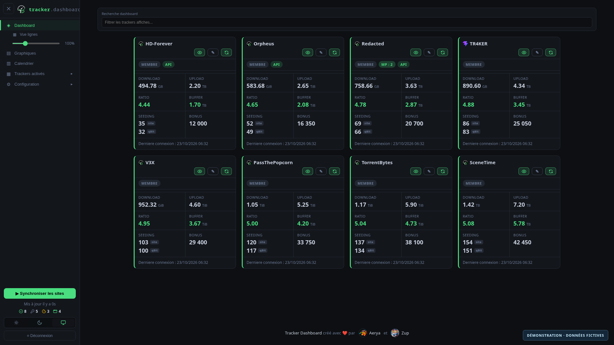
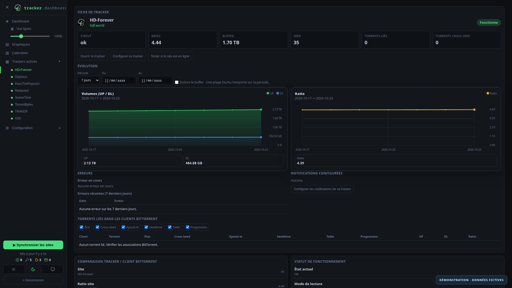
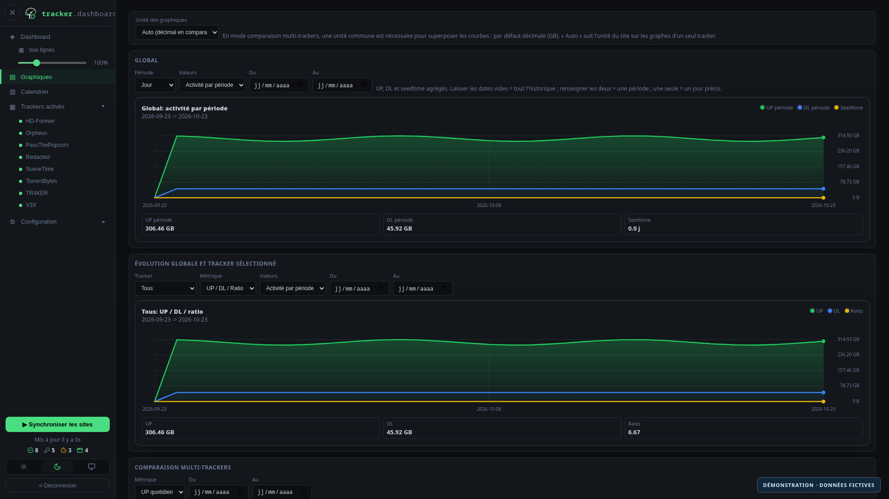
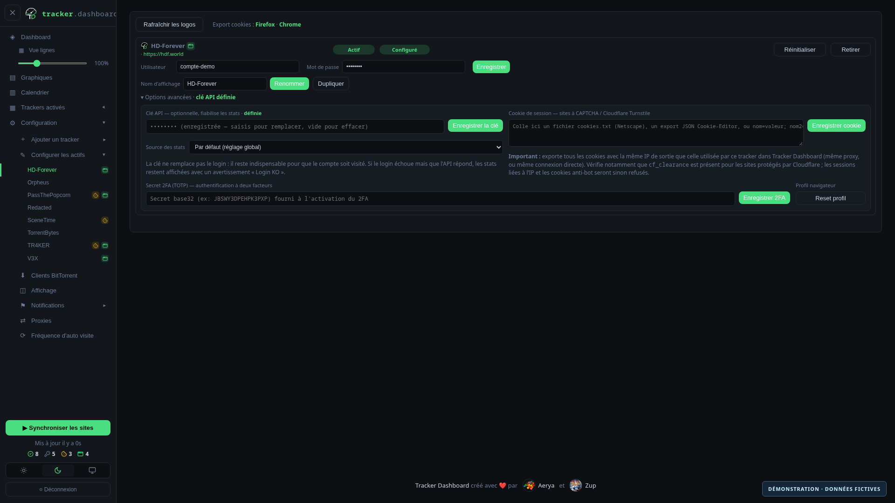

<p align="center">
  
</p>

# Tracker Dashboard

Tracker Dashboard réunit les statistiques de vos trackers BitTorrent dans une interface web : upload, download, ratio, buffer, points bonus, torrents en seed et messages privés non lus, selon les données disponibles sur chaque site. Il planifie les visites, conserve un historique SQLite et compare les statistiques des trackers aux torrents présents dans vos clients BitTorrent.

Le projet est porté par l’organisation [Tracker-Dashboard](https://github.com/Tracker-Dashboard), en collaboration avec [Zup](https://github.com/Gusdezup) ([Autovisit-Web](https://github.com/Gusdezup/Autovisit-Web)). **Toute aide est la bienvenue** : corrections, nouveaux trackers, documentation et nouvelles fonctionnalités.

<p align="center">
  <strong>Vous l’utilisez ? Vous l’appréciez ?</strong>
  <a href="https://github.com/Tracker-Dashboard/tracker-dashboard/stargazers"><strong>⭐ Ajoutez une étoile !</strong></a>
</p>

## Sommaire

- [Fonctionnalités](#fonctionnalités)
- [Dernières nouveautés](#dernières-nouveautés)
- [Installation et premier démarrage](#installation-et-premier-démarrage)
- [Interface](#interface)
- [Cookies de session](#cookies-de-session-sites-à-captcha--cloudflare)
- [Statistiques via les API des trackers](#statistiques-via-les-api-des-trackers)
- [Double authentification des trackers](#double-authentification-2fa--totp)
- [Plusieurs comptes par tracker](#plusieurs-comptes-par-tracker)
- [Captures d’écran](#captures-décran)
- [Connexions automatiques](#connexions-automatiques)
- [Clients BitTorrent et cross-seed](#clients-bittorrent)
- [Notifications](#notifications)
- [Prometheus et Grafana](#prometheus-et-grafana)
- [Sécurité proxy](#sécurité-proxy)
- [Runtime navigateur, FlareSolverr et TRAWL](#runtime-navigateur)
- [Lecture rapide](#lecture-rapide-curl-impersonate)
- [User-Agent aléatoire](#user-agent-aléatoire)
- [Sites intégrés et ajout d’un site](#sites-intégrés--ajout-dun-site)
- [Remerciements](#remerciements)

## Fonctionnalités

| Domaine | Ce que propose Tracker Dashboard |
| --- | --- |
| **Statistiques** | Cartes ou lignes, ratio, buffer, volumes UP/DL, bonus, classe de membre et MP non lus selon le tracker ; lecture des pages et API compatibles |
| **Historique** | Stockage SQLite, courbes d’évolution, comparaisons multi-trackers et calendrier des lectures réussies ou en échec |
| **Visites automatiques** | Planification globale ou individuelle, rafraîchissement manuel, cache et nouvelles tentatives après certains échecs |
| **Comptes multiples** | Duplication d’un tracker, identifiants et historique indépendants, noms personnalisables et attribution des torrents par passkey |
| **Clients BitTorrent** | qBittorrent et ruTorrent/rTorrent, rapprochement des annonces, comparaison du seeding et liens vers plusieurs instances cross-seed |
| **Authentification des trackers** | Identifiants, cookies de session, TOTP et clés API selon les méthodes prises en charge par chaque site |
| **Réseau et navigateurs** | Proxies HTTP/HTTPS/SOCKS/SSH, curl-impersonate, runtime Chromium séparé, CloakBrowser facultatif et replis FlareSolverr/TRAWL |
| **Notifications** | Discord, Apprise et e-mail ; réglages globaux ou par tracker, erreurs, rétablissements, statistiques et seuils |
| **Supervision** | Export Prometheus protégé par jeton et tableau de bord Grafana fourni |
| **Personnalisation** | Thèmes clair/sombre/système, taille des cartes, notes, incidents connus et assistant d’ajout de trackers |

## Dernières nouveautés

<details>
<summary>Afficher les dernières nouveautés</summary>

Évolutions intégrées à la branche principale, des plus récentes aux plus anciennes. La disponibilité sur votre instance dépend de l’image installée.

### Octobre 2026

- **22 octobre — Échecs de connexion plus visibles :** encadré « Login en échec » repliable lorsque l’API fournit encore les statistiques, notifications aux erreurs raccourcies et conservation de l’alerte après redémarrage. ([#221](https://github.com/Tracker-Dashboard/tracker-dashboard/pull/221), [#222](https://github.com/Tracker-Dashboard/tracker-dashboard/pull/222))
- **22 octobre — Images Docker et sécurité :** actualisation de la base Node 22, contrôle hebdomadaire de sa disponibilité et scan des images publiées ; reconstruction hebdomadaire uniquement si la base a changé. ([#219](https://github.com/Tracker-Dashboard/tracker-dashboard/pull/219), [#220](https://github.com/Tracker-Dashboard/tracker-dashboard/pull/220))
- **17 octobre — AstraTorrent V3 :** correction des volumes, du Karma et des seeds sur le nouveau portail, prise en compte de l’absence de ratio et conservation des associations avec les annonces historiques. ([#217](https://github.com/Tracker-Dashboard/tracker-dashboard/pull/217))
- **12 octobre — Nostradamus :** download et seeding lus depuis la page Activity ; taux journalier laissé vide lorsqu’il n’est pas disponible. ([#214](https://github.com/Tracker-Dashboard/tracker-dashboard/pull/214))
- **9 octobre — Statistiques par API :** clés personnelles, choix de la source des statistiques, badges API/API KO, suivi des H&R lorsque disponible et maintien de l’alerte si la connexion au site échoue malgré une API fonctionnelle. Lecture V3X plus précise et corrections des unités sur HD-Forever et TR4KER. ([#213](https://github.com/Tracker-Dashboard/tracker-dashboard/pull/213))
- **6–7 octobre — SceneTime et TorrentBytes :** ajout des deux trackers et lecture de leur classe de membre ; SceneTime utilise un cookie de session. ([#209](https://github.com/Tracker-Dashboard/tracker-dashboard/pull/209), [#210](https://github.com/Tracker-Dashboard/tracker-dashboard/pull/210), [#211](https://github.com/Tracker-Dashboard/tracker-dashboard/pull/211))
- **4 octobre — V3X :** seeding et points bonus lus depuis « Mon activité ». ([#206](https://github.com/Tracker-Dashboard/tracker-dashboard/pull/206))

### Septembre 2026

- **26 septembre — TRAWL :** correction du niveau de journalisation fourni dans Compose et les templates Unraid. ([#204](https://github.com/Tracker-Dashboard/tracker-dashboard/pull/204))
- **23 septembre — Runtime navigateur :** dépendances CloakBrowser isolées de l’application principale, publication indépendante et compatibilité contrôlée par version de protocole. ([#201](https://github.com/Tracker-Dashboard/tracker-dashboard/pull/201), [#202](https://github.com/Tracker-Dashboard/tracker-dashboard/pull/202))
- **21–22 septembre — TR4KER :** lecture des points bonus, du seeding et de la classe de membre. ([#199](https://github.com/Tracker-Dashboard/tracker-dashboard/pull/199), [#200](https://github.com/Tracker-Dashboard/tracker-dashboard/pull/200))
- **21 septembre — Planification avec cookie seul :** les trackers sans identifiants mais avec un cookie enregistré participent aux rafraîchissements automatiques. ([#198](https://github.com/Tracker-Dashboard/tracker-dashboard/pull/198))
- **20 septembre — Sessions et nouveaux trackers :** C411 passe au cookie de session uniquement ; ajout de PassThePopcorn avec authentification par cookie. ([#195](https://github.com/Tracker-Dashboard/tracker-dashboard/pull/195), [#192](https://github.com/Tracker-Dashboard/tracker-dashboard/pull/192))
- **17–20 septembre — Interface :** actions des cartes sous forme d’icônes accessibles et corrections de la disposition des cartes étroites et des champs de configuration. ([#187](https://github.com/Tracker-Dashboard/tracker-dashboard/pull/187), [#193](https://github.com/Tracker-Dashboard/tracker-dashboard/pull/193), [#194](https://github.com/Tracker-Dashboard/tracker-dashboard/pull/194))
- **1er septembre — Draupnirr :** nouveau nom et domaine de l’ancien Yggrasil ; l’identifiant technique `yggrasil` est conservé pour préserver la configuration existante.

Les fonctionnalités plus anciennes sont présentées dans les sections ci-dessous. L’[historique des modifications](https://github.com/Tracker-Dashboard/tracker-dashboard/commits/main/) permet de retrouver les autres corrections et mises à jour de dépendances.

</details>

## Installation et premier démarrage

1. Créez une stack dans Dockge-Enhanced ou votre gestionnaire Docker Compose à partir du fichier [docker-compose.yml](docker-compose.yml) fourni. Il contient l’application principale, le runtime navigateur, FlareSolverr et TRAWL.
2. Choisissez le port publié sur l’hôte (`3000` par défaut) et un dossier persistant pour le montage `./config:/app/config`. Conservez et sauvegardez ce dossier : il contient votre configuration et l’historique.
3. Démarrez la stack, ouvrez `http://adresse-du-serveur:3000` (ou le port choisi), puis créez le compte administrateur de la WebUI.
4. Dans **Configuration → Proxies**, configurez un proxy ou autorisez explicitement les connexions directes. Par défaut, les visites des trackers sont bloquées sans proxy actif.
5. Ajoutez vos trackers, renseignez leurs identifiants ou leur cookie selon le site, puis configurez la fréquence des visites. Vous pouvez ensuite associer vos clients BitTorrent et vos notifications.

**Unraid :** des templates bêta permettent d’installer les services séparément. Consultez le [guide Unraid](unraid/README.md).

> [!NOTE]
> Le premier rafraîchissement peut prendre du temps, notamment pour les trackers lus via navigateur. Les dernières données valides sont conservées en cache. En cas d’échec ponctuel, relancez la lecture du tracker concerné et consultez sa fiche pour voir l’erreur.

## Interface

La navigation se fait depuis la barre latérale gauche :

- **Dashboard** : vue d'ensemble des trackers (cartes ou lignes, bascule sous le menu). Chaque carte peut porter un « incident connu » et une note libre.
- **Graphiques** : Global (UP/DL/seedtime agrégés), Évolution (par tracker ou « Tous »), comparaison multi-trackers (sélection libre des trackers), Totaux par tracker. Chaque graphe a un sélecteur de période et une plage de dates Du/Au.
- **Calendrier** : calendrier des refreshs (OK/KO par jour) ; un tracker en KO renvoie vers sa configuration.
- **Trackers activés** : accordéon listant les trackers actifs ; un clic ouvre la **fiche** du tracker.
- **Configuration** : *Ajouter un tracker* (sites non activés), *Configurer les actifs*, *Clients BitTorrent*, *Notifications* (Canaux, Notifications globales, Par tracker), *Proxies*, *Fréquence d'auto visite*.
- En bas : *Synchroniser les sites*, horodatage de dernière mise à jour, bascule de thème **Clair / Sombre / Système**, déconnexion.

### Fiche d'un tracker

- En-tête : logo, nom, lien vers le site, badge de statut (OK / cassé / données anciennes).
- Stats actuelles : ratio, buffer, UP, DL, seed, torrents client.
- **Courbes d'évolution** : Volumes (UP / DL, buffer en option) et Ratio, sur 7 jours / 30 jours / Tout ou une plage Du/Au.
- **Comment ce tracker est lu** : mode de lecture (login auto / cookie collé / captcha), dernière lecture réussie, cookie et 2FA définis ou non.
- **Erreurs** : erreur en cours, erreurs récentes (7 jours), historique complet.
- **Notifications configurées** : reprend les notifications du menu Notifications applicables au tracker (sinon « Aucune »).
- **Torrents liés** : torrents détectés dans vos clients BitTorrent pour ce tracker (état, taille, UP/DL/ratio), avec import des associations non reconnues.

## Cookies de session (sites à CAPTCHA / Cloudflare)

Certains trackers protègent leur login par un CAPTCHA ou un challenge anti-bot (Cloudflare Turnstile…). Le navigateur headless ne peut pas les résoudre. Pour ces sites, fournissez directement un **cookie de session** : connectez-vous dans votre navigateur, exportez tous les cookies du site, puis collez-les dans **Configuration → Configurer les actifs → (le tracker) → Options avancées → Cookie de session**. Le dashboard les injecte avant chaque lecture et saute la page de login. **Les cookies doivent être créés avec la même IP de sortie que celle utilisée par ce tracker dans Tracker Dashboard** : activez donc dans votre navigateur le même proxy que celui configuré pour le tracker, ou utilisez la même connexion directe si aucun proxy ne lui est affecté. Vérifiez notamment que `cf_clearance` est présent pour les sites protégés par Cloudflare ; sinon, les sessions liées à l'IP et les cookies anti-bot seront refusés.

Trois formats auto-détectés :
- fichier **Netscape `cookies.txt`** ;
- export **JSON** d'une extension type *Cookie-Editor* ;
- chaîne brute `nom=valeur; nom2=valeur2` copiée depuis les DevTools.

Extensions pratiques : [cookies-txt](https://github.com/hrdl-github/cookies-txt), [Cookie-Editor](https://cookie-editor.com/), [Get cookies.txt LOCALLY](https://github.com/kairi003/Get-cookies.txt-LOCALLY).

Le cookie est optionnel et propre à chaque tracker ; il finit par expirer, il suffit alors d'en recoller un frais.

## Statistiques via les API des trackers

Lorsqu’une définition le permet, Tracker Dashboard peut compléter les données lues sur le site avec son API. Dans **Configuration → Configurer les actifs → (le tracker) → Options avancées**, renseignez votre **clé API personnelle**, et l’identifiant API si le site le demande, puis choisissez la source des statistiques : **Par défaut**, **API** ou **Scraping**. Une préférence globale permet de privilégier l’API quand elle est disponible.

Cette lecture est notamment prévue pour HD-Forever, Redacted, Orpheus, Phoenix Project, PassThePopcorn et TR4KER, ainsi que dans le preset UNIT3D pour les sites compatibles. Les champs disponibles dépendent du tracker. Les clés restent côté serveur et ne sont pas renvoyées en clair à l’interface.

**La clé API ne remplace pas la visite du site.** La connexion et la lecture habituelles restent tentées à chaque rafraîchissement. Si la connexion échoue mais que l’API répond, les statistiques restent visibles avec un avertissement **Login en échec**, car le compte peut ne plus être considéré comme actif par le site. Cet avertissement reste affiché après un redémarrage. Les badges **API** et **API KO** indiquent le résultat de la lecture complémentaire.

## Double authentification (2FA / TOTP)

Pour les trackers en 2FA basée sur le temps (TOTP), le dashboard génère lui-même le code à 6 chiffres. Renseignez le **secret 2FA** (clé base32 affichée à l'activation, ex. `JBSWY3DPEHPK3PXP`) dans **Options avancées → Secret 2FA (TOTP)** du tracker.

- Secret stocké côté serveur, jamais renvoyé en clair par l'API.
- Code calculé en local (RFC 6238, HMAC-SHA1, 6 chiffres, fenêtre 30 s).
- **Flux en deux étapes** (Laravel Fortify / UNIT3D) : le code est soumis automatiquement sur la page de challenge. Pris en charge en HTTP, curl-impersonate et navigateur.
- **Flux en une étape** : `login.otpField` ou placeholder `{{otp}}` dans le corps de login.

Laissez le champ vide pour les trackers sans 2FA.

## Plusieurs comptes par tracker

Pour suivre **plusieurs comptes sur un même site**, dupliquez un tracker : dans **Configuration → Configurer les actifs → (le tracker)**, cliquez sur **Dupliquer**. Un nouveau compte « (2) » est créé, prêt à recevoir ses identifiants.

- Le duplicata reprend la **même mécanique de login** que le tracker d'origine et **hérite automatiquement** des corrections de login publiées par la suite.
- **Identifiants, cookie, 2FA, profil navigateur, statistiques, planning et notifications sont indépendants** entre comptes.
- **Nom d'affichage modifiable** : sur la fiche de configuration de chaque compte, champ **Nom d'affichage** + **Renommer** (ex. « C411 », « C411 Alex », « C411 Ishem »).
- Dans la barre latérale (« Configurer les actifs » et « Trackers activés »), les comptes d'un même site sont **regroupés sous le nom du site**, dépliable.
- Un compte dupliqué est **supprimable** (bouton **Supprimer** sur sa fiche) ; le tracker intégré d'origine, lui, ne peut être que désactivé.

### Attribution des torrents par passkey

Quand un site a plusieurs comptes, les torrents de vos clients BitTorrent sont ventilés par **passkey** (celle présente dans l'URL d'annonce). Sur la **fiche** d'un compte, la section **Attribution des annonces** liste les passkeys détectées (affichées masquées) ; attribuez chacune au bon compte. Les torrents correspondants — et leurs statistiques — suivent alors le compte choisi. Avec un seul compte, rien ne change : l'attribution automatique par hôte reste utilisée.

## Captures d'écran

Captures de l’interface actuelle avec un jeu de démonstration entièrement fictif : statistiques, historique et compte d’exemple. Aucune donnée d’une installation personnelle n’est utilisée.

### Dashboard

Vue d’ensemble des trackers, badges API, messages non lus et comparaison du seeding entre site et client BitTorrent.



<details>
<summary>Voir la fiche tracker, les graphiques et la configuration</summary>

### Fiche d’un tracker

Statistiques, évolution des volumes et du ratio, erreurs et torrents liés.



### Graphiques

Suivi global et évolution des statistiques à partir d’un historique de démonstration.



### Configuration

Compte d’exemple, choix de la source des statistiques, clé API, cookie et TOTP.



</details>

## Connexions automatiques

La planification se règle dans **Configuration → Fréquence d'auto visite** :

- **Planification globale** : trois modes — toutes les *X* heures, tous les *X* jours à heure fixe, ou certains jours de la semaine. Chaque cycle visite les trackers actifs disposant d’identifiants ou d’un cookie de session enregistré.
- **Fréquences individuelles** : par tracker, on peut suivre la planification globale, la désactiver, ou fixer un intervalle propre (en heures).
- **Synchroniser les sites** (bas de la barre latérale) lance un rafraîchissement manuel immédiat.

En cas de timeout ponctuel non marqué comme incident, les dernières données valides restent affichées avec un indicateur, puis le dashboard retente automatiquement 3 fois toutes les 10 minutes, puis 3 fois toutes les heures, avant la prochaine connexion planifiée.

## Clients BitTorrent

Dans **Configuration → Clients BitTorrent**, ajoutez un ou plusieurs clients **qBittorrent** ou **ruTorrent/rTorrent** (URL d'API, identifiants). Le dashboard agrège les torrents par hôte d'annonce et les rapproche de vos trackers, ce qui alimente la fiche de chaque tracker.

- Un lien **Ouvrir** mène à l'interface du client.
- Chaque client a un champ **Auto (j / h)** : intervalle de rafraîchissement automatique (0 = désactivé). Les données sont aussi exposées à Prometheus (`tracker_qbit_*`).

### Instances cross-seed

Dans la même page, la section **Instances cross-seed** permet d'associer une ou plusieurs instances [cross-seed](https://github.com/cross-seed/cross-seed) à leurs clients BitTorrent :

- renseignez l'URL de la WebUI cross-seed (port par défaut `2468`) et sélectionnez tous les clients qBittorrent ou ruTorrent/rTorrent alimentés par cette instance ;
- conservez les marqueurs par défaut `cross-seed-link, cross-seed`, ou indiquez le `linkCategory`, la catégorie ou le tag utilisé par votre installation ;
- lancez une synchronisation des clients BitTorrent : le logo cross-seed apparaît discrètement près des trackers et des torrents concernés ;
- cliquez sur le logo ou sur **Ouvrir cross-seed** dans une fiche tracker pour rejoindre directement la bonne WebUI.

Tracker Dashboard identifie les torrents depuis les catégories et tags réellement remontés par le client BitTorrent. Aucune clé API cross-seed n'est nécessaire et aucune route tRPC interne n'est utilisée. Si plusieurs instances alimentent le même client, configurez un marqueur distinct par instance afin de conserver une attribution non ambiguë.

## Notifications

Configurables dans **Configuration → Notifications**, en trois volets :

- **Canaux** : destinations **Discord**, **Apprise** ou **e-mail**.
- **Notifications globales** : échecs, succès, rétablissement après échec, statistiques, MP non lus.
- **Par tracker** : réglages spécifiques (échecs, succès, stats, MP, seuils de ratio / buffer / ancienneté de session) qui priment sur les réglages globaux.

## Prometheus et Grafana

L’endpoint `/metrics` expose les statistiques des trackers activés (`tracker_*`) et des clients BitTorrent (`tracker_qbit_*`). La métrique `tracker_api_up` indique le résultat des lectures API lorsqu’elles sont configurées.

Définissez **`METRICS_TOKEN`** sur le service principal et utilisez ce jeton comme Bearer token dans Prometheus. Sans jeton, l’export est désactivé par défaut et renvoie HTTP 503. Le fichier [grafana/dashboard.json](grafana/dashboard.json) fournit un tableau de bord à importer ; le [guide Prometheus et Grafana](grafana/README.md) détaille la configuration.

## Sécurité proxy

Par défaut, les connexions aux trackers sont **bloquées si aucun proxy n'est actif**. Pour autoriser les connexions, il faut soit :
- configurer et activer un proxy,
- cocher explicitement l'option de connexion directe sans proxy (utile si le conteneur sort déjà via un VPN au niveau du réseau Docker).

Cette sécurité s'applique aussi au premier lancement.

Types pris en charge : **HTTP**, **HTTPS**, **SOCKS4**, **SOCKS5** et **SSH** — en proxy global comme en override par tracker.

### Proxy SSH

Avec le type **SSH**, le dashboard ouvre un tunnel SSH (SOCKS5 local adossé au forwarding dynamique) pour sortir via l'IP d'un serveur auquel vous avez un accès SSH.

- Renseignez **hôte / port / utilisateur**, puis **un mot de passe OU une clé privée** (PEM OpenSSH, passphrase acceptée).
- Les secrets sont stockés côté serveur, jamais renvoyés en clair (masqués).
- Le bouton **Tester** établit le tunnel et vérifie l'IP de sortie.

## Runtime navigateur

### Unraid — templates bêta

Des templates Unraid sont disponibles pour installer séparément l'application, le runtime navigateur, FlareSolverr et TRAWL sans Docker Compose. Consultez le [guide Unraid](unraid/README.md). Nous recherchons activement des retours avant une éventuelle publication dans Community Applications.

Le navigateur (Playwright/Chromium/CloakBrowser) est externalisé dans l'image `ghcr.io/tracker-dashboard/tracker-dashboard-browser:latest`. L'image principale reste allégée.

Le fichier `docker-compose.yml` fourni inclut déjà ce runtime. Au démarrage, l'application attend sa disponibilité pendant 30 secondes maximum avant de rafraîchir les trackers en `mode: browser`. Ce délai peut être ajusté avec `BROWSER_RUNTIME_BOOT_WAIT_MS` sur le service principal.

Pour une stack Compose existante qui ne contient pas encore le runtime, ajoutez ce service :

```yaml
services:
  tracker-dashboard-browser:
    image: ghcr.io/tracker-dashboard/tracker-dashboard-browser:latest
    container_name: tracker-dashboard-browser
    restart: unless-stopped
    network_mode: "container:tracker-dashboard"
    volumes_from:
      - tracker-dashboard
```

La clé est bien `volumes_from` au pluriel. `volume_from` est invalide.

Équivalent en commande Docker :

```bash
docker run -d \
  --name tracker-dashboard-browser \
  --restart unless-stopped \
  --network container:tracker-dashboard \
  --volumes-from tracker-dashboard \
  ghcr.io/tracker-dashboard/tracker-dashboard-browser:latest
```

Avec `--network container:tracker-dashboard`, Tracker Dashboard joint automatiquement le runtime sur `http://127.0.0.1:3001`. Avec `--volumes-from tracker-dashboard`, les profils navigateur et cookies restent sur le même volume `./config`. Le service navigateur ne touche pas la base : l'app principale reste la source de vérité et lui transmet ce qu'il faut par appel interne.

Si le runtime navigateur est absent, les trackers en `mode: browser` affichent une erreur claire et la WebUI donne la commande d'installation. L'état et les versions (Playwright/Chromium/CloakBrowser) sont visibles dans **Proxies → Moteur navigateur → Runtime navigateur**. La WebUI signale aussi si le protocole du runtime navigateur n'est pas compatible avec l'application ; les révisions restent affichées comme information de traçabilité.

### Moteur navigateur (CloakBrowser)

Les lectures en mode navigateur utilisent **Chromium** (Playwright) par défaut. Une option (panneau Proxies → Moteur navigateur) bascule sur **[CloakBrowser](https://github.com/CloakHQ/CloakBrowser)**, un Chromium modifié pour présenter une empreinte de vrai navigateur (TLS, fingerprint) et franchir davantage de protections anti-bot. S'il est indisponible, l'app repart automatiquement sur Chromium.

### Repli Cloudflare (FlareSolverr puis TRAWL)

Tracker Dashboard peut utiliser **[FlareSolverr](https://github.com/FlareSolverr/FlareSolverr)** en dernier recours lorsqu'un tracker renvoie explicitement un challenge Cloudflare ou anti-bot. Si FlareSolverr échoue ou reste injoignable, l'application tente ensuite **[TRAWL](https://github.com/germondai/trawl)** via son API compatible FlareSolverr. Les sidecars reçoivent uniquement l'URL, les cookies et le proxy du tracker concerné, résolvent le challenge dans une session temporaire, renvoient le HTML puis détruisent cette session. Les erreurs de credentials, de réseau ou d'extraction ne déclenchent pas ces navigateurs supplémentaires. Un tracker connu pour nécessiter ce repli, comme YGGReborn, peut le déclarer en priorité après les lectures HTTP légères.

Le fichier `docker-compose.yml` fourni inclut déjà FlareSolverr et TRAWL. Pour une stack existante, ajoutez d'abord FlareSolverr :

```yaml
services:
  tracker-dashboard-flaresolverr:
    image: ghcr.io/flaresolverr/flaresolverr:latest
    container_name: tracker-dashboard-flaresolverr
    restart: unless-stopped
    network_mode: "container:tracker-dashboard"
    environment:
      HOST: 127.0.0.1
      # Évite de journaliser les corps de requête, qui contiennent les cookies de session.
      LOG_LEVEL: warning
      TZ: Europe/Paris
```

Ajoutez ensuite TRAWL comme secours. L'image `baseline` est retenue pour sa compatibilité avec les vieux CPU, les anciens kernels et les NAS Synology ; ce n'est pas une promesse de consommation CPU/RAM plus basse que FlareSolverr.

```yaml
services:
  tracker-dashboard-trawl:
    image: ghcr.io/germondai/trawl:baseline
    container_name: tracker-dashboard-trawl
    restart: unless-stopped
    network_mode: "container:tracker-dashboard"
    environment:
      PORT: 8192
      LOG_LEVEL: warn
      TZ: Europe/Paris
```

Le partage du réseau du conteneur principal est important : FlareSolverr est alors joignable en interne sur `http://127.0.0.1:8191`, TRAWL sur `http://127.0.0.1:8192`, et les deux réutilisent aussi les tunnels SOCKS locaux des proxies SSH. Aucun port anti-bot n'est exposé sur l'hôte. Une URL différente peut être fournie avec `FLARESOLVERR_URL` ou `TRAWL_URL`.

## Lecture rapide (curl-impersonate)

**[curl-impersonate](https://github.com/lexiforest/curl-impersonate)** usurpe l'empreinte TLS/HTTP2 d'un vrai Chrome et franchit le filtrage anti-bot passif sans navigateur. Le dashboard l'utilise automatiquement pour le login HTTP complet et pour les trackers navigateur disposant d'un cookie. Le repli est automatique (aucune lecture cassée). Réglage : panneau Proxies → Moteur navigateur → *Lecture rapide* (activé par défaut).

## User-Agent aléatoire

Rotation automatique de User-Agents (paquet `top-user-agents`) pour les nouvelles sessions HTTP et contextes navigateur.

## Sites intégrés & ajout d'un site

Les définitions de sites intégrées sont fournies dans `config/trackers/*.json` (un fichier JSON par site : connexion, page à lire, champs à extraire). Les nouvelles définitions sont détectées au démarrage et proposées à l'activation.

Pour préparer l'ajout d'un site, fournissez idéalement : nom, URL de base, URL de login (et méthode particulière éventuelle), URL de la page de stats, son HTML une fois connecté, les valeurs à récupérer, et le CMS éventuel (UNIT3D, Gazelle, Luminance…).

Champs habituels :

| Champ | Usage |
|---|---|
| `uploadedBytes` | Upload |
| `downloadedBytes` | Download |
| `ratio` | Ratio |
| `bufferBytes` | Buffer |
| `seeding` | Torrents en seed |
| `seedBonus` | Points bonus |
| `tokens` | Jetons / tokens |
| `unreadMessages` | MP non lus |

Le ratio peut être calculé depuis upload/download s'il n'est pas exposé ; idem pour le buffer.

### Format simplifié d'une définition

```json
{
  "id": "example",
  "name": "Example Tracker",
  "baseUrl": "https://example.org",
  "enabled": false,
  "login": {
    "url": "login",
    "method": "POST",
    "contentType": "form",
    "body": { "username": "{{username}}", "password": "{{password}}" },
    "failurePatterns": ["login"]
  },
  "fetch": {
    "url": "account",
    "mode": "http",
    "responseType": "html",
    "fields": {
      "uploadedBytes": {
        "regex": "Upload[^0-9]*(?<value>[0-9.,]+\\s*(?:GB|GiB|TB|TiB))",
        "transform": "bytes"
      }
    }
  }
}
```

### Transformations disponibles

| Transformation | Effet |
|---|---|
| `bytes` | Convertit `1.5 GB`, `800 MiB`, `2 To`, `276 Gio`… en octets |
| `number` | Nombre décimal |
| `integer` | Entier |
| `string` | Conserve le texte |

## Remerciements

- [Autovisit](https://github.com/Gusdezup/Autovisit) — idée de la prise en charge du 2FA (TOTP).
- [CloakBrowser](https://github.com/CloakHQ/CloakBrowser) — moteur Chromium furtif proposé en option.
- [FlareSolverr](https://github.com/FlareSolverr/FlareSolverr) — résolution de challenges Cloudflare via un sidecar interne optionnel.
- [TRAWL](https://github.com/germondai/trawl) — secours anti-bot compatible FlareSolverr lorsque le premier repli échoue.
- [cross-seed](https://github.com/cross-seed/cross-seed) — détection des torrents injectés et logo officiel (licence Apache-2.0).
- Et tous les contributeurs qui partagent des définitions de trackers.
